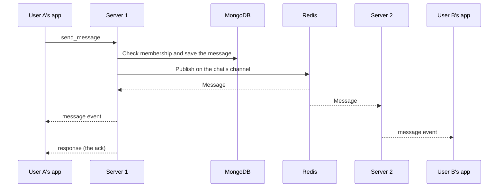

# How live messages travel

This page explains how a chat message reaches everyone in a chat, even when they are
connected to different servers. For message formats, see
[WEBSOCKET_PROTOCOL.md](./WEBSOCKET_PROTOCOL.md).

## The problem

ECHO can run as several copies of the server, called instances. Each instance only knows
the people connected to it. If User A is on server 1 and User B is on server 2, server 1
can't reach User B directly.

Redis solves this with **pub/sub** (publish and subscribe). It works like radio: a server
publishes a message on a named channel, and every server listening to that channel hears
it. Each server then passes the message to its own connections.

## The three parts

| Part | Code | Job |
|---|---|---|
| Hub | `internal/realtime/hub.go` | Tracks who is connected to this server and which chats each connection follows |
| Pub/sub manager | `internal/realtime/pubsub.go` | Talks to Redis: subscribes, publishes, and hands incoming messages to the right connections |
| Presence manager | `internal/realtime/presence.go` | A simple in-memory list of users connected to this server |

The hub keeps four lookup tables:

| Map | Answers the question |
|---|---|
| `Clients` | Which connections are open on this server? |
| `ChatClients` | Which connections follow this chat? |
| `UserClients` | Which connections belong to this user? |
| `UserActiveChats` | Which chats does this user follow? |

These maps must only be touched while holding `hub.Mutex`. To use one after unlocking, copy
what you need first. Never wait on a hub channel while holding the lock. Registration,
`JoinChat` and `LeaveChat` still publish to Redis under it, which can slow other work.

## The path of one message

1. The server checks that the sender is a participant of the chat.
2. It saves the message to MongoDB and updates the chat's last message.
3. It publishes the message to Redis on `chat:<chatID>`.
4. Every server listening to that channel looks up `ChatClients[chatID]` and passes the
   message to its local connections.
5. The sender gets a `response`. It can arrive before or after their own `message` event.

Three facts worth remembering:

- **Everything goes through Redis,** even when both people are on the same server. There is
  no local shortcut.
- **Direct chats and groups use the same path.** Both use `chat:<chatID>`.
- **The message is saved first.** If live delivery fails, it is still in the chat history.

Other chat events (typing, reactions and so on) use the same channel. In the code, services
call `BroadcastToChat`, which calls the hub's `PublishToChat`.

## Redis channels

| Channel | Meant for | Used today? |
|---|---|---|
| `chat:<chatID>` | All events of one chat | **Yes.** This is the main path. |
| `presence:global` | Online and offline updates | Yes, but unreliable (#31) |
| `user:<userID>` | Messages for one person | No. Servers listen, but nothing publishes to it. |
| `system:global` | Announcements to everyone | No. Servers listen, but nothing publishes to it. |
| `instance:<instanceID>` | Messages for one server | No. Servers listen, but nothing publishes to it. |

The server also writes a normal Redis key, `presence:<userID>`, every 30 seconds. It expires
after 2 minutes, and nothing reads it yet (#31).

## Connecting and disconnecting

**When someone connects,** the hub:

1. Reads the `chats` list on the user's MongoDB document, and keeps only the chats where
   the user is also in `participants` (`GetUserChats`). Before #9 was fixed, a forged
   invite code could add a chat to the list without making the user a participant.
2. Subscribes this server to `user:<userID>` and to `chat:<chatID>` for each of those chats.
3. Adds the connection to its lookup tables.
4. Sends the welcome message.

This runs on one goroutine, one connection at a time. That is why the server accepts about
1,750 new connections per second, and why one slow call delays everyone else (#22).

The list is only read at this moment. Chats added later aren't picked up until the person
reconnects. See
[which chats you get live events for](./WEBSOCKET_PROTOCOL.md#which-chats-you-get-live-events-for).

**When someone disconnects,** the hub removes the connection from its tables. When a user's
last connection closes, it is also meant to drop the Redis subscriptions and tell others
the user went offline. Neither works properly yet (#20, #31).

**When a connection is too slow,** its queue of 10 outgoing messages fills up and the server
disconnects it.

## Background jobs

| How often | What it does |
|---|---|
| Every 30 seconds | Removes connections with no activity for 5 minutes, and clears expired cache entries |
| Every 30 seconds | Writes `presence:<userID>` to Redis for connected users |

Each server also keeps user display names in memory for 5 minutes, so it doesn't have to ask
MongoDB every time.

## Running several servers

The design supports this: add instances behind a load balancer, and Redis connects them.
Apps can reconnect to any instance. The [performance numbers](./product-overview.md#performance)
come from one server, so they don't measure this setup.

Redis pub/sub keeps nothing. A message published while a server isn't listening never reaches
its connections live, though it is still in the chat history (#43).

## Troubleshooting

| What you see | What to check |
|---|---|
| A message is saved but doesn't arrive live | Does the person's connection follow the chat? They may need to reconnect. Also check #14 and #17. |
| Nobody gets live messages | Is Redis up? Look for publish errors in the server log. |
| Memory or Redis connections keep growing | Known problems: #20, #21 |
| Online status is wrong | Known problem: #31 |

`GET /echo/v1/chats/hub/stats` shows the counts and channels for one server. See
[rest-api.md](./rest-api.md#hub-statistics).

## Known problems

| Issue | Problem |
|---|---|
| #20 | Redis subscriptions aren't cleaned up on disconnect |
| #21 | Each Redis channel uses its own connection, so connections grow with users and chats |
| #22 | Slow MongoDB or Redis calls hold up all connects and disconnects |
| #54 | A client that disconnects before it is registered stays registered until cleanup |
| #55 | `JoinChat` can lose its Redis subscription to a disconnect at the same time; fix it with #20 |
| #14, #17 | Who gets live messages doesn't match who is in the group |
| #31 | Online status is unreliable |
| #40 | No size limit or rate limit on incoming messages |
| #43 | Apps can't detect or recover missed live messages |

Not built, and only ideas so far: delivery to offline users, message encryption, compression,
and retrying a failed publish.
