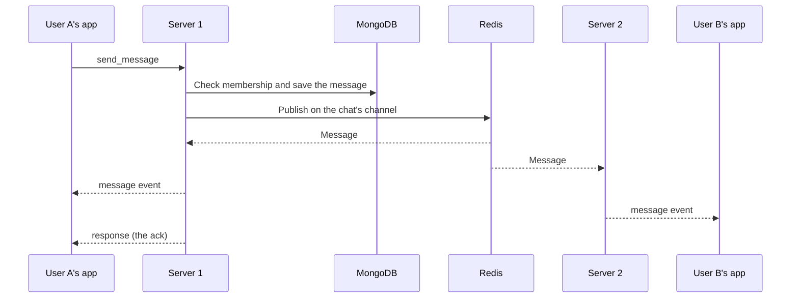

# How live messages travel

This page explains how a chat message reaches everyone in a chat, even when they are
connected to different servers. For message formats, see
[WEBSOCKET_PROTOCOL.md](./WEBSOCKET_PROTOCOL.md).

## The problem

ECHO can run as several copies of the server, called instances. Each instance only knows
the people connected to it. If User A is on server 1 and User B is on server 2, server 1
can't reach User B directly.

Redis solves this with **pub/sub** (publish and subscribe). It works like radio: a server
publishes a message on a named channel, and every server listening to that channel hears
it. Each server then passes the message to its own connections.

## The three parts

| Part | Code | Job |
|---|---|---|
| Hub | `internal/realtime/hub.go` | Tracks who is connected to this server and which chats each connection follows |
| Pub/sub manager | `internal/realtime/pubsub.go` | Talks to Redis: subscribes, publishes, and hands incoming messages to the right connections |
| Presence manager | `internal/realtime/presence.go` | A simple in-memory list of users connected to this server |

The hub keeps four lookup tables:

| Map | Answers the question |
|---|---|
| `Clients` | Which connections are open on this server? |
| `ChatClients` | Which connections follow this chat? |
| `UserClients` | Which connections belong to this user? |
| `ClientChats` | Which chats does this connection follow? (A user's chats are the union over their connections.) |
| `PendingClients` | Which connections of this user are queued but not registered yet? A user with one isn't "gone" (#22). |

These maps must only be touched while holding `hub.Mutex`. To use one after unlocking, copy
what you need first. Never wait on a hub channel while holding the lock. `JoinChat` and
`LeaveChat` still publish to Redis under it, which can slow other work.

The hub goroutine (`runHub`) only changes maps; it never waits on MongoDB or Redis (#22).
Each registration runs in its own goroutine, at most 32 at once: it reads the user's
chats (at most 5 seconds), changes the maps, subscribes, then announces the user as
online if no other connection of theirs has. If the chats can't be read or the user
channel can't be subscribed, the connection is closed with `1011` and the app
reconnects. A disconnect changes the maps on the hub goroutine and leaves the channel
releases and the offline publish to a goroutine. It counts as the user's last only if
no other connection is registered or still queued. One user's online and offline
publishes share a lock, so they can't land in the wrong order. Connections queue
themselves with `QueueRegister` and `QueueUnregister`, which give up once the hub has
stopped. A Redis subscribe waits at most 5 seconds for its confirmation.

## The path of one message

1. The server checks that the sender is a participant of the chat.
2. It saves the message to MongoDB and updates the chat's last message.
3. It publishes the message to Redis on `chat:<chatID>`.
4. Every server listening to that channel looks up `ChatClients[chatID]` and passes the
   message to its local connections.
5. The sender gets a `response`. It can arrive before or after their own `message` event.

Three facts worth remembering:

- **Everything goes through Redis,** even when both people are on the same server. There is
  no local shortcut.
- **Direct chats and groups use the same path.** Both use `chat:<chatID>`.
- **The message is saved first.** If live delivery fails, it is still in the chat history.

Other chat events (typing, reactions and so on) use the same channel. In the code, services
call `BroadcastToChat`, which calls the hub's `PublishToChat`.

## Redis channels

| Channel | Meant for | Used today? |
|---|---|---|
| `chat:<chatID>` | All events of one chat | **Yes.** This is the main path. It also carries `internal.members_removed` after `remove_user`: each server takes those users' connections out of the room, and never forwards it. Being on the same channel keeps its place after the `chat_updated` (#14). |
| `presence:global` | Online and offline updates | Yes, but unreliable (#31) |
| `user:<userID>` | Messages for one person | Only `internal.chat_added`: when the person gains a chat (a new direct chat, a group they created or joined with a code), each server puts their connections in its room and subscribes to it, and never forwards it (#49). |
| `system:global` | Announcements to everyone | No. Servers listen, but nothing publishes to it. |
| `instance:<instanceID>` | Messages for one server | No. Servers listen, but nothing publishes to it. |
| `control:sessions` | Close a user's connections on every server (logout, deleted profile) | **Yes** (#76). Never forwarded to clients. |

The server also writes a normal Redis key, `presence:<userID>`, every 30 seconds. It expires
after 2 minutes, and nothing reads it yet (#31).

## Connecting and disconnecting

**When someone connects,** the hub, in a goroutine of its own for that connection:

1. Reads the `chats` list on the user's MongoDB document, and keeps only the chats where
   the user is also in `participants` and not pending (`GetUserChats`). A startup repair
   removes entries for chats that don't list the user (#69).
2. Adds the connection to its lookup tables.
3. Subscribes this server to `user:<userID>` and to `chat:<chatID>` for each of those chats.
4. Announces the user as online, if this is their first connection here.
5. Sends the welcome message.

Up to 32 connections go through these steps at once, so a slow call delays only the
connections waiting on it (#22).

The list is only read at this moment. A chat gained later reaches the open connections
through `internal.chat_added` on `user:<userID>` (#49). A connection registering in the
same few milliseconds as the add can miss it until it reconnects, and a removal right
after an add can be applied first; the membership re-check (#117) fixes that within 30 s. See
[which chats you get live events for](./WEBSOCKET_PROTOCOL.md#which-chats-you-get-live-events-for).

**When someone disconnects,** the hub takes the connection out of every room it is in and
unsubscribes each chat channel whose room is left empty on this server. When a user's last
connection closes, it also drops the `user:<id>` channel and tells others the user went
offline; the offline part doesn't work properly yet (#31). `leave_chat` and `remove_user`
release a chat's channel the same way when they empty its room. A join always enters the
room before it subscribes, and a release re-subscribes if someone joined while it was
closing the channel, so a join is never left without a subscription (#55). The
`user:<id>` channel works the same way, since registrations and disconnects of one user
can overlap (#22). The other
way round, a join or registration checks the room again after subscribing and releases
the channel if a removal emptied it meanwhile (#123). Messages published in that short
gap are missed (#43). A connection that drops while its
registration still waits in the queue can have its disconnect handled first; that closes
its send queue, and the registration then skips it instead of adding a dead connection
(#54). The server reads a connection's requests only after the hub has handled its
registration (waiting at most 10 seconds), so a `join_chat` sent right after connecting
can't run before the connection's rooms are set and be dropped (#122).

**When a connection is too slow,** its queue of 10 outgoing messages fills up and the server
disconnects it.

## Background jobs

| How often | What it does |
|---|---|
| Every 30 seconds | Removes connections with no activity for 5 minutes, and clears expired cache entries |
| Every 30 seconds | Writes `presence:<userID>` to Redis for connected users |
| Every 30 seconds | Re-checks each open connection's token and account, and closes those that may no longer be used (#76) |
| Every 30 seconds, after that | Reads the participants of every room's chat (200 chats per query) and takes out the connections of users who aren't members any more. This catches what `internal.members_removed` missed: a reconnect racing `remove_user`, or Redis failing during it (#117). A failed read removes nobody |

Each server also keeps user display names in memory for 5 minutes, so it doesn't have to ask
MongoDB every time.

## Running several servers

The design supports this: add instances behind a load balancer, and Redis connects them.
Apps can reconnect to any instance. The [performance numbers](./product-overview.md#performance)
come from one server, so they don't measure this setup.

Redis pub/sub keeps nothing. A message published while a server isn't listening never reaches
its connections live, though it is still in the chat history (#43).

## Troubleshooting

| What you see | What to check |
|---|---|
| A message is saved but doesn't arrive live | Does the person's connection follow the chat? A pending member gets nothing live until they accept (#5). Look for "may not follow a new chat" in the server log (#49). |
| Nobody gets live messages | Is Redis up? Look for publish errors in the server log. |
| Memory or Redis connections keep growing | Known problem: #21 |
| Online status is wrong | Known problem: #31 |

`GET /echo/v1/chats/hub/stats` shows the counts for one server, to operators who send the
stats token. See
[rest-api/](./rest-api/chats.md#hub-statistics).

## Known problems

| Issue | Problem |
|---|---|
| #21 | Each Redis channel uses its own connection, so connections grow with users and chats |
| #31 | Online status is unreliable |
| #40 | Rate limits are per socket, not per account |
| #43 | Apps can't detect or recover missed live messages |

Not built, and only ideas so far: delivery to offline users, message encryption, compression,
and retrying a failed publish.
