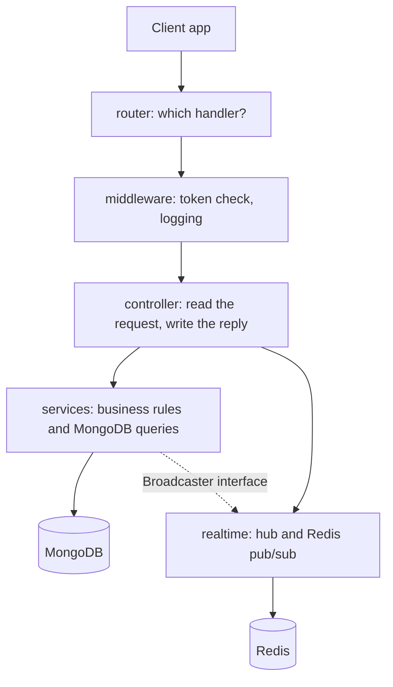

# ECHO: architecture overview

How the server is built, for someone reading the code for the first time. Everything here
was checked against the code at `17ec08b` on `main`, except what is marked **Target**:
that is where we want to go, and the code doesn't do it yet.

How live messages work is in [PUBSUB_ARCHITECTURE.md](./PUBSUB_ARCHITECTURE.md). The message
formats are in [WEBSOCKET_PROTOCOL.md](./WEBSOCKET_PROTOCOL.md).

## What it is

A Go server with a REST API (built with Gin) and one WebSocket endpoint. MongoDB stores the
data. Redis keeps the logout list and passes live messages between servers.

It ships as a Docker image to Render. Every merge to `main` deploys automatically
(`render.yaml`, `autoDeploy: true`). The Android app lives elsewhere; `Android/` holds only
its plans.

## How a request moves through the code

## Code map

| Package | What it does | Depends on |
|---|---|---|
| `cmd/server` | Starts everything: config → logger → MongoDB → background index build and owner-role repair → Redis → hub → HTTP server. Shuts down cleanly. | everything below |
| `cmd/cleandb` | Developer tool: wipes MongoDB and Redis | config, database |
| `internal/config` | Reads settings from the environment and an optional `.env` file. The environment wins. | — |
| `internal/constants` | Shared names: collections, API path, statuses, roles | — |
| `internal/logger` | JSON logging with request IDs | — |
| `internal/router` | The list of routes under `/echo/v1/` | controller, middleware |
| `internal/middleware` | Token check (with the Redis logout list and the account check), CORS, request logging | config, database, models, services, utils |
| `internal/controller` | HTTP and WebSocket handlers: read the request, call a service, turn errors into replies | services, realtime, models, utils, database (auth only) |
| `internal/services` | Business rules and MongoDB queries for chats, messages, users, contacts and invites. Also startup data repairs (`migrations.go`). | database, models, utils |
| `internal/realtime` | The WebSocket hub, Redis pub/sub and in-memory presence | database, models, services |
| `internal/models` | Data shapes: MongoDB documents, API payloads, WebSocket messages | — |
| `internal/database` | MongoDB and Redis connections, index definitions | config |
| `internal/utils` | Tokens, reply helpers, default values, invite code encryption | config, models |
| `internal/testutil` | Test helpers shared across packages (throwaway test database) | database |

`constants` and `logger` are used almost everywhere, so the table leaves them out.

**Why `Broadcaster` exists:** `services` must send live events, but `realtime` already
imports `services`, and Go doesn't allow import loops. So `services` declares a small
`Broadcaster` interface, and the hub plugs itself in at startup with
`services.SetBroadcaster`.

## Main flows

1. **Log in:** `POST /login` → check the password with bcrypt → return a JWT that lasts 7
   days. The token carries the user's details, account status and presence. On every
   request the middleware checks the Redis logout list, then whether the account still
   exists and isn't banned or inactive (`services.CheckAccountAccess`, read from MongoDB
   and cached in Redis for 30 seconds). Open WebSockets are re-checked every 30 seconds, and
   logout and delete close them at once through `control:sessions` (#76).
2. **Connect:** `GET /ws/chat` with the token → the hub reads `users.chats` from MongoDB and
   keeps the chats where the user is in `participants` → subscribes to `user:<id>` and
   `chat:<id>` in Redis → adds the connection to `ChatClients`.
3. **Send a message:** `send_message` → check membership (`GetChat`) → save the message →
   update the chat → publish on `chat:<id>` → every server passes it to its local
   connections in `ChatClients[chatID]`.
4. **Load history:** `GET /messages/:chatID/messages?before=<id>` → check membership → read
   one page using the index `chatId_1__id_-1`.
5. **Groups and invites:** create a group (the creator as owner, others as pending members,
   plus one invite code), add or remove members (owner or admin), join with an invite code.

## Data model

MongoDB has three collections.

- **`users`:** profile, presence, contact lists (`contactInfo`, including the one-sided
  `blocked` and hidden `blockedBy` lists), `chats` (a map of chat ID to unread count) and
  `chatInvitations`. Emails are unique, enforced by an index.
- **`chats`:** `participants` (a map keyed by user ID, holding role, status and a copy of
  the user's details), `inviteCode[]`, `readReceipts`, `typingUsers` and `stats`. No extra
  indexes.
- **`messages`:** `chatId`, a copy of the sender's details, content, a `reactions` map and a
  `readBy` map.

**Watch out: membership is stored in two places.** `chats.participants` decides who may send
and read. `users.chats` decides what a connection follows live, limited to chats that also
list the user in `participants`. The two can still disagree, which
causes #14, #17 and #28. Choosing one is an open decision in
[current-state.md](./current-state.md#open-decisions).

## Target layers (not yet enforced)

**Target:** each layer may only use the layers listed in its row.

| Layer | May import | Must not import |
|---|---|---|
| controller | services, realtime, models, utils | database |
| services | database, models, utils | controller, realtime, gin |
| realtime | services (via interfaces), models, database | controller |
| models | stdlib, bson | everything internal |

One known exception today: `controller/auth.controller.go` uses `database` directly. Nothing
checks these rules automatically yet. The plan is `depguard` in golangci-lint, which is
deferred (see [ai-harness-setup.md](./ai-harness-setup.md)).

## Riskiest areas

Take extra care when changing these places.

| Area | Why it is risky | Where | Issue |
|---|---|---|---|
| Disconnect cleanup | Subscriptions and old connections are left behind | `internal/realtime/hub.go:242` | #20 |
| One Redis connection per channel | Connections grow with users and chats | `internal/realtime/pubsub.go:165` | #21 |
| Block model | Blocks aren't enforced in chats; the startup block migration runs only once | `internal/services/chat.service.go`, `internal/services/migrations.go` | #27, #63 |
| Account deletion | Deleting an account leaves its ID behind in chats and contact lists | `internal/services/user.service.go:108` | #35 |
| Writes across several documents | No transactions, so an update can half-finish | `services/chat.service.go`, `contact.service.go` | #37 |
| Invite codes | The encryption key is in the public source code, so anyone can read a code | `internal/utils/defaultInitialization.go:155` | #15 |
