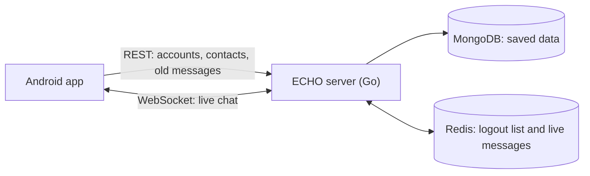

# ECHO: product overview

ECHO is the server behind a real-time chat app. People sign up, add contacts, and chat one
to one or in groups. Messages arrive instantly and are saved, so people can read them
later.

This repository holds the server only. The Android app is built separately; the `Android/`
folder here holds its plans. New to these words? See the [glossary](./glossary.md).

## How it works

- **REST API:** normal web requests for things that happen once, such as logging in or
  loading old messages. See [rest-api.md](./rest-api.md).
- **WebSocket:** a connection that stays open, so messages arrive the moment they are
  sent. See [WEBSOCKET_PROTOCOL.md](./WEBSOCKET_PROTOCOL.md).
- **MongoDB:** stores everything that must last: users, chats and messages.
- **Redis:** keeps the list of logged-out tokens and passes live messages between servers.
  The server won't start without it.

## What works today

Checked against the code at `17ec08b`. Numbers like `#33` are GitHub issues.

| Feature | What people can do | Status | Known gaps |
|---|---|---|---|
| Accounts | Sign up, log in (lasts 7 days), log out | Works | Banned or deleted users stay logged in until their token ends (#33). Also #34, #36. |
| Profiles | View, edit and delete your profile; view other people's | Works | Deleting a profile leaves old references behind (#35). |
| Finding people | Get suggestions of people to add | Works | The "nearby" and "popular" lists are empty placeholders. |
| Contacts | Send, accept and decline requests; remove; favorites; block and unblock | Partly works | Blocks aren't enforced in chats (#27). Also #38, #39, #62, #63. |
| Direct chats | Start a chat with one person | Works | Someone already online gets no live messages from a new chat until they reconnect (#49). |
| Group chats | Create a group; add and remove members | Partly works | Added members are never asked to accept (#5) and get no live messages (#17). Removed members keep getting them until they reconnect (#14). Also #16, #28. |
| Invite codes | Create, list, delete and send codes; join with a code | Partly works | Codes can be forged (#9, #15). Also #29, #30. |
| Live messages | Send and receive instantly | Works | Missed messages can't be detected (#43). |
| Message history | Load old messages, page by page | Works | |
| Typing, read receipts, reactions | See who is typing, who has read a message, and emoji reactions | Partly works | Reaction counts can drift (#25). Emoji values aren't checked (#58). |
| Online status | See who is online | Unreliable | Often wrong (#31). Privacy settings are saved but not applied (#32). |
| Attachments | Send a link to a file, with its details | Partly works | There is no file upload. The app must store the file elsewhere and send its URL. |

## Not built yet

- Editing or deleting messages, and changing chat settings. The server answers
  `NOT_IMPLEMENTED`.
- Accepting or declining a group invite (#5).
- A way to list your chats. There is no REST route for it.
- Broadcast channels. The `channel` chat type exists in the code, but nothing creates one.
- File upload, message search and push notifications.
- Setting your status over the WebSocket. `set_presence` answers `UNKNOWN_REQUEST`.
- Rate limiting (#40).

## Security in short

- **Passwords** are hashed with bcrypt.
- **Login** uses a signed token (JWT, HS256). Every route except `signup`, `login` and
  `/health` needs it in the `Authorization: Bearer <token>` header.
- **Logout** puts the token on a list in Redis until it would have expired. If Redis can't
  answer, the server lets the token through, so nobody gets locked out.
- **Chat history** can only be read by participants. Everyone else gets `404`, the same as
  for a chat that doesn't exist, so nobody can test whether a chat ID is real.
- **Group roles** are `owner`, `admin` and `member`. Only owners and admins can add or
  remove members.
- **Profile edits** are limited to an allow list of fields.
- **Browser access (CORS)** is open to any site. No cookies are used.

Open security bugs: #9, #15, #24, #33, #34, #58, #59.

## Performance

Measured with the load test in [`scripts/load-test`](../scripts/load-test), which explains
how to repeat it.

| Metric | Result |
|---|---|
| Open WebSocket connections at once | 14,000 held, 0 failed |
| New connections accepted | ~1,750 per second |
| Time to set up a connection (p95) | ~85–195 ms |
| Send a message, save it, get the ack (p50) | ~12 ms |
| Same round trip (p95) | ~16–50 ms |
| Same round trip (p99) | ~20–70 ms |
| Messages handled, sustained | ~1,600–1,900 per second |
| Messages lost | 0 in all runs |

p50 means half of the messages were faster than this. p95 means 95 out of 100 were. Ranges
cover several runs at each level. The first run after a start is slower because the server
is warming up.

**How to read these numbers**

- **They come from a developer's machine.** One server, with MongoDB and Redis in Docker,
  all on one Intel i5-10400F (12 threads, 16 GB) running Windows 11. Use them to spot
  slowdowns between versions. They don't promise production capacity.
- **Tested at** 1,000, 5,000, 8,000 and 14,000 connections.
- **The limit was the test machine, not the server.** Connections reached about 15,300
  before the machine creating them ran out of local network ports (`ENOBUFS`).
- **New connections are the slow part.** They are handled one at a time, and each needs a
  MongoDB lookup and a Redis subscribe (#22). That sets the limit of about 1,750 per
  second. Connections already open stay fast.
- **"0 lost" has limits.** Nothing disconnects during the load test, so it doesn't cover
  messages missed during a reconnect (#43).
- **One server only.** Running several servers is supported by design, but these numbers
  don't measure it.

## License

This repository has no license file yet.
